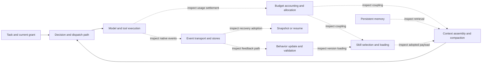

# Harness evaluation: architecture, mechanisms and measurable effects

This is the detailed measurement contract for the [focused two-layer plan](architecture-core.md), revision `focused-two-layer-six-dimension-r4`. Seven harness studies remain; they are architecture studies, not feature checklists. The machine-readable definitions live in [architecture-core.json](architecture-core.json). Product architectures and results are **not yet established** by this design.

Every conclusion must connect four things: **source-backed ownership and component interactions → controlled intervention → independently measured task/resource effect → an evidence-linked visualization**. A successful feature demonstration establishes only that run's behavior. It does not explain which component caused it or what boundary the mechanism protects.

## One run supplies performance, resource and cost evidence

All arms in both layers collect the same ledger. A study's two primary dimensions organize the explanation; they do not limit measurement. Compare the same task, input, model/version, tools and permissions, except for the explicit intervention. Record failure, cancellation, budget termination and partial work alongside success. Lower cost from incomplete work must be visible.

| Measure | Required definition | Breakdown and interpretation |
| --- | --- | --- |
| Task completion time | External submission/admission to independently accepted required artifact; separate terminal-failure latency | Cold/warm startup, queue, model wait, skill/context/memory processing, tools and recovery; show overlapping spans and the critical path, never add parallel durations as serial wall time. Cleanup has its own duration. |
| Token usage | Raw provider usage plus a normalized ledger in which each request is counted once | By request/attempt, parent/child, task/selection/compaction/retrieval/update/validation stage; separately, actual input payload segments for system, skill, memory, history, tool results and current task. Cached input/reasoning may be subsets, not extra tokens to add. |
| CPU | Cumulative core-seconds over the stated process/cgroup lifetime, including exited children | Harness, tool/child processes, shared services, fixture/observer separately. Shared-service total and attributable delta are different quantities. Instantaneous CPU percent is insufficient. |
| Memory | Named method: cgroup peak, sampled PSS or labeled RSS; sampling cadence, baseline, peak and byte-seconds | Harness, child/tool and resident shared-service memory. Summed RSS can double-count shared pages; do not compare it silently to PSS. Short peaks missed by sampling remain a limitation. |
| Disk | Initial, peak incremental and retained allocated bytes; logical bytes and read/write I/O separately | Workspace, logs/events, snapshots, memory indexes, generated skills and cache. Measure before/during/after task and after native cleanup; track shared/COW/deduplicated storage without double-counting. |
| Task effect | Frozen independent assertions, weighted quality and critical constraints | Include all required assertions and failed attempts. Show exact pass/fail components and uncertainty, not a cost-only ranking. Cost per accepted artifact is N/A if none succeeds. |

Tokenizer-based segment sizes are estimates with tokenizer/version and residuals; they must not be silently substituted for provider usage. Request-stage and input-segment views are alternative decompositions of the same requests, not two totals to add. Report unavailable categories and observation coverage. Money is optional and requires a pinned pricing date and billable-category contract; token counts alone are not a universally comparable currency.

Use aligned task/event/resource time series and paired quality-versus-time/token/CPU/memory/disk panels. Display per-block points. Two blocks support mechanism reproducibility observations, not p95/p99, broad significance tests or overall product rankings. Probes, requests and holdout questions nested in a block are not independent experimental repetitions.

## Required architecture evidence

For each product and study, bind a declared deployment/version before formal execution. Record native entry/configuration keys; pinned file/symbol or public-contract anchors; state stores, namespaces and lifetimes; component write/read authority; observed event IDs; and the actual task/request that adopts a decision. Label each graph edge `observed`, `source_only`, `hypothesis` or `unresolved`. State the enforcement/decision owner even when it is an OS primitive, external service, model, extension or user.

The following is a **question map**, not a claim that every harness implements these connections:

An absent budget-to-skill link is a valid finding. Lack of a native component switch means that ablation is unsupported; changing core code or having the adapter supply the missing mechanism cannot establish native behavior. If a switch also changes other behavior, declare the confound and limit attribution.

## HE: rollback scope, granularity and collateral effects

Determine separately **what is captured**, **what can be selected for restoration**, **what physically changes**, and **what is interrupted during restoration**. Candidate boundaries include object/file, tool step, turn/checkpoint, agent, session, workspace, shared service, container and VM. These are inspection questions, not assumed capabilities. Identify the backend: transcript replay, object versioning, file revert, database transaction, filesystem snapshot or process/VM snapshot, if supported by evidence.

Use one disposable test host containing the full witness topology below. The external supervisor is outside the restore domain. The test host represents an OS; protection supplied by its outer containment is not credited as product isolation. All peer processes/files are synthetic test assets. This topology is necessary to test OS peers, not a reason to mutate unrelated production files.

| Owner group | State/progress witnesses | What the experiment distinguishes |
| --- | --- | --- |
| Target agent | Conversation/cursor, memory/skill version, workspace and pending/completed operation receipts | Intended rollback scope and consistency of the next actual request |
| Same-session sibling agent | Private artifacts, native child result, process/heartbeat, acknowledged writes | Agent-local versus session-wide restoration and cancellation |
| Another session | Private and intentionally shared workspace/store entries, accepted task progress | Session isolation versus workspace/store-level coupling |
| OS peers outside the agent workspace | Independent test process with PID/start time, heartbeat, held test file, synthetic files elsewhere on the same test filesystem | Process restarts/stalls, descriptor/content mismatch, broad filesystem restoration |
| External service | Synthetic committed-effect ledger outside local restoration | Persistence, duplicate replay, compensation or unresolved effects |

Create actor-tagged objects with create/update/delete/rename operations and relevant metadata. Include an intentionally shared object with per-actor acknowledged writes. Record two native checkpoint IDs and object versions; choose one checkpoint age per block in advance, held constant across its arms. Freeze expected changes and expected preservation per native restore operation before execution. Sample witnesses during the operation as well as before/after it. Run peers through a known acknowledged mutation boundary; after restoration verify their continuation and monotonic progress. A heartbeat gap alone can be contention, not evidence of process death: correlate it with PID/start time, exit records, native locks and paired controls.

Four conditions use the same fixture: uninterrupted control; interrupted native resume; interrupted finest supported restore; interrupted coarsest distinct supported restore. Ordinary resume isolates whether restoration changes state beyond continuation. Fine/coarse differ only in native restore scope at the same checkpoint. If the product has only one granularity, explicitly mark the distinct-granularity comparison unavailable; never simulate it with wrapper backups. A second checkpoint tests native time/version selection without multiplying every age by every scope.

Report raw counts and rates by owner/domain:

- **Restore fidelity** = correctly restored observable in-scope objects / observable objects expected to restore.
- **Collateral change** = unexpectedly changed observable out-of-scope objects / observable out-of-scope objects.
- **Actual affected footprint** = changed objects/bytes, restarted or paused processes, and affected agents/sessions, split into declared and undeclared effects. A documented whole-workspace rollback may have zero contract violations while still disrupting other agents; show both facts.
- **Lost peer writes** = acknowledged peer writes absent after restore; distinguish writes intentionally included in the chosen scope from unexpected losses.
- **Peer disruption** = unexpected exit/restart count, heartbeat gap and accepted-task latency delta against matched witnesses.
- **Recovery cost/effect** = snapshot bytes and creation/restore time, post-restore accepted task quality, retained/duplicate external effects.

Required figures: an **owner × state-domain × restore-granularity matrix**, with expected and actual restored/retained/lost/unobservable values; a **target/sibling/session/OS-peer timeline**; and **restoration time/storage versus task-quality points** carrying collateral-effect labels. This makes granularity and impact visible even when the API reports a successful restore.

## HF: budget architecture and skill/context coupling

Map the cumulative-use accountant, any reservation/allocator, the dispatcher, child budget inheritance, context-capacity planner, skill selector/loader, compactor and memory retriever. Locate the source/configuration and actual event connecting them. Context capacity, cumulative token budget and per-response output limits are distinct channels. Determine whether control is advisory, post-response accounting, pre-dispatch reservation or another evidenced mechanism.

Keep four deterministic mechanism conditions: sufficient/exhausted single-run budget and sufficient/exhausted shared-child budget. A tiny fixed request sequence and synchronized child arrivals reveal reservation/settlement and overshoot. Synthetic provider usage verifies control transitions; it cannot establish real-task quality or billing accuracy.

Add one compact **six-cell real-task comparison**:

| Native strategy | Roomy budget | Tight but pilot-feasible budget |
| --- | --- | --- |
| Normal adaptive behavior | Shared baseline | Budget-pressure response |
| Only skill selection/loading policy fixed | Skill ablation baseline | Skill contribution under pressure |
| Only context allocation/compaction policy fixed | Context ablation baseline | Context contribution under pressure |

Choose native fixed policies before viewing formal outcomes, keeping the same eligible skills and task instructions. Skill-fixed may use a native fixed/eager loading option; context-fixed may freeze a supported allocation/compaction setting. The exact native controls must be bound in preparation. Do not paste replacement skill text, truncate requests in the adapter, disable unrelated safety rules, or combine both ablations. If native independent controls do not exist, retain direct observations but mark the causal ablation unavailable. Keep model version fixed; automatic model changes are an explicit confound unless separately accounted for. Two budget levels reveal a local interaction, not a full scaling curve.

Observe actual request segments, selected skill versions, loaded detail, reserved output space, retained task facts, compaction/retrieval decisions, child allocations, settlement and dispatch. Report the common resource ledger plus quality, constraint retention, counter error, overshoot and post-exhaustion calls. The six-cell task should have a genuinely feasible tight condition from pilot, so it can reveal useful adaptation rather than merely guaranteed failure; the deterministic exhausted conditions already test stopping behavior.

For each separately fixed component, compute paired interaction:

`(quality_adaptive,tight − quality_fixed,tight) − (quality_adaptive,roomy − quality_fixed,roomy)`

Apply the same contrast to total tokens and latency, with appropriate units. This distinguishes a budget-pressure-specific contribution from a strategy that helps regardless of budget. Require every involved cell and verify only the intended setting changed; otherwise no causal interaction claim. Report raw cell values and all failures. Do not infer a joint skill×context interaction from two separate ablations.

Required figures: a **source-backed budget/skill/context flow graph**, a **remaining/reserved/consumed budget timeline with decision markers**, **input-token composition by source**, **paired task-quality/cost plots**, and **interaction plots**. Include the CPU/memory/disk cost of selection, compaction and caching from the same runs.

## HG: self-improvement architecture and measured benefit

Trace **feedback source → candidate proposer → mutable artifact → validation → promotion/rejection → version registry → fresh-session loader → actual behavior → reversal**. Identify which stages are native, model-decided, user-controlled or absent. Inspect trust, authority, trigger, scope and persistent versioning. A modified file without proof that later sessions load it is not demonstrated adaptation.

Retain frozen, updated and reverted conditions, with the updated/reverted arms sharing the same candidate. Use one training-feedback episode and one permitted native proposal per block. Freeze the independent transfer and regression tasks before adaptation; the proposer cannot see them. Keep model/version, ordinary task history and incidental memory controlled. If state cannot be separated, report that confound. Native promotion checks use visible training validation, not the sealed evaluator. Observe actual namespace/version adoption in the target and witness session; shared updates are described by scope, not automatically labeled contamination.

Measure per-case quality before/after/revert, critical constraint failures, baseline-passing assertions lost, intended/unintended adoption, and adaptation-stage plus per-use time/token/CPU/memory/disk cost. A rejected candidate is a valid outcome; there is no unlimited search until a good result appears.

- **Transfer gain** = updated quality − frozen quality on the same sealed transfer case.
- **Regression rate** = baseline-passing assertions that become failing / eligible baseline-passing assertions; a zero denominator is N/A.
- **Reversal fidelity** = restored state/behavior assertions / declared reversible assertions, supported by the actually loaded version.
- **Conditional token break-even uses** = ceiling of adaptation tokens divided by positive per-use token savings, only if the predeclared quality and regression guard is satisfied. Otherwise N/A. This is a workload-specific projection, not measured lifetime improvement; report time and storage changes separately.

Required figures: **candidate/version/validation lineage**, **frozen→updated→reverted per-task paired scores**, **regression matrix**, **adaptation-stage resource cost**, and a clearly labeled **conditional amortization projection**. Small holdouts demonstrate a mechanism and local effects, not long-term autonomous progress.

## HA, HB, HC and HD use the same standard

| Study | Mechanism and component links | Quantified effect | Figure |
| --- | --- | --- | --- |
| HA context/memory | Assembly order/priority, skill loading, memory retrieval, compaction trigger and adoption in the next request | Retained current constraints, final adherence, source token allocation, full management cost | Context composition, constraint survival matrix, quality/cost points; reuse HF native ablations with identical evidence IDs |
| HB collaboration | Scheduler, state ownership, context/skill/grant inheritance, join/retry/cancel propagation | Same-work accepted quality, critical path/speedup, duplicated context, all child costs and orphan work | Parent/child/model/tool Gantt and quality/overhead points |
| HC sandbox/authority | Grant→dispatch→OS boundary→effect; inherited permission and shared state identity | Reached forbidden effects, false denial of allowed operations, policy/launch cost and peer impact | Actor/route×file/network/process/memory outcome matrix and policy/effect timeline |
| HD extension/execution | Registration, queue, native/extension lifecycle and policy/usage/error handoff | Equivalent-operation time/token/resource delta, actual overlap and retained successful results | Ownership graph and model/dispatcher/tool/result Gantt |

Sandbox outcomes separate not attempted, harness blocked, OS blocked, actual forbidden effect, unsupported and unobservable. Positive controls must prove reachability. A model's refusal is behavioral evidence; it does not test the OS enforcement point. A fixture/outer-host denial cannot earn native sandbox credit. For all mechanisms, explain improvements and regressions with actual adopted state and traversed control edges.

## Logs and events: semantics, diagnostic value and cost

Logs are records; events may also drive execution, state updates, recovery or user subscriptions. Determine which role each native surface plays. Do not assume that formatted logs imply a durable event bus, or that exported telemetry is the authoritative execution state.

| Comparison | Architectural question | Reused intervention and metric |
| --- | --- | --- |
| Generation and correlation | Who emits events, with what run/actor/call/version/causal IDs and schema? | Known HB/HD transitions; correlate eligible action facts with native records, show missing links and wrong associations |
| Transport and delivery | In-process callbacks, queue, IPC, broker or storage? What ordering and delivery scope is promised? | Call/failure/cancel traces; generated/delivered/persisted counts if observable, duplicate IDs and causal-order violations within the stated scope |
| Durability and replay | What is acknowledged/persisted, and what survives restart? Is replay deduplicated? | HE's existing interruption/recovery; native offsets/IDs before/after, retained facts and duplicate processing, without adding a crash matrix |
| Slow consumers | Does the producer block, buffer, discard, disconnect a subscriber or retry? Are other consumers affected? | One HD native consumer temporarily held and released; queue high-water/drop count, delivery lag, producer/task progress and drain outcome |
| Diagnostic usability | Can records explain the failed call, authority, recovery version or budget decision? | Blinded native-only reconstruction against independent truth; correct/wrong/missing fact counts and diagnosis time |
| Recording overhead | What does more detailed logging cost or change? | Same HD four-read task under default versus native diagnostic logging; paired time/token/CPU/memory/disk and artifact-quality differences |

HD adds only two matched conditions to its existing batched control: diagnostic logging and one held event consumer. Use a native/public subscription hook and native verbosity setting. If unavailable, report the specific contrast unsupported. Blocking stdout is not a substitute for an internal consumer. A second healthy subscriber is observed only if native fan-out exists. Freeze the hold interval from pilot, release it, and wait for classified task/consumer-drain completion. This is a small mechanism intervention, not a saturation/throughput benchmark.

Expected actions do not prove an event was generated. Without emitter IDs or sequence information, report **action coverage**, not a fictional delivery-loss percentage. Generation-to-delivery lag requires comparable clocks. Global ordering is not required when the contract promises only per-run ordering. Distinguish event loss, invisible instrumentation, deliberate filtering and retention expiry. External collector survival proves neither native persistence nor execution recovery.

Required figures: an **emitter→transport/buffer→subscriber/store graph**, a **causal swimlane with gaps/duplicates/replay**, **queue and producer-progress traces**, and **paired diagnostic-overhead panels** from the common ledger. No additional quality-free logging score or overall radar ranking is required.

## Data and figure contract

| Artifact | Minimum fields |
| --- | --- |
| Architecture map | product/version, node/edge ID, owner, state scope, native config, pinned source anchor, supporting event IDs, evidence status |
| `events.jsonl` | block/arm/run/actor/parent/call/event IDs where native, type, monotonic time/clock domain, causal/sequence/version references, source/provenance, action/delivery/persistence status |
| `objects.csv` | owner/session/namespace/domain, object ID, selected restore scope, expected action, before/checkpoint/mutated/after versions or canonical digests, writer receipt, observation status |
| `metrics.csv` | product/deployment/study/block/condition/task/actor/stage, metric ID, value, unit, numerator/denominator where relevant, method/scope, source reference, observed/estimated/unobservable/unsupported/blocked disposition |
| `contrasts.csv` | contrast ID, paired unit IDs, outcome/units, difference or interaction definition, eligibility, confounds, missing-arm reason |
| Figures | plotted metric/contrast IDs, raw-data link, units, denominator/count, paired block IDs, observation status and limitation; absent data shown explicitly |

No result values or product architecture edges are invented to populate charts. The current delivery is the plan, measurement definitions and visualization specifications; runner/collectors, validated metric evaluators and actual charts await native binding and execution. The planner validates that every harness study has architecture/coupling questions, evidence binding, contrasts, metric definitions/denominators/missing policies and valid chart references. It does not certify that a runtime collector measures those quantities correctly.

Scope remains ten studies: three platform and seven harness. The revised plan enumerates 60 complete product/fixture blocks and 318 condition arms. The increase from 264 is explicit: one HE granularity contrast, six HF task-effect cells and two HD event/log contrasts, each across three products and two blocks. These are not 318 independent tasks or a duration estimate: some arms contain nested probes/holdouts and several native calls. Pilot estimates must inventory these stages, witness setup, observation, cleanup and unsupported surfaces. No automatic model/platform/load sweep, universal task cutoff or campaign kill budget is introduced.
