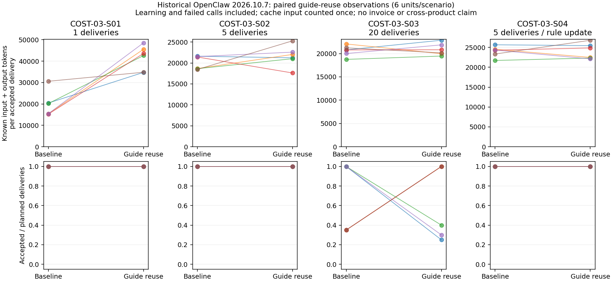
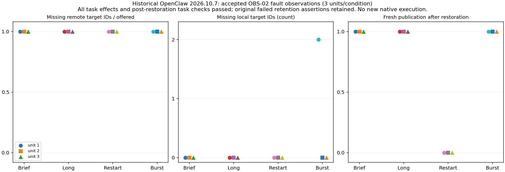
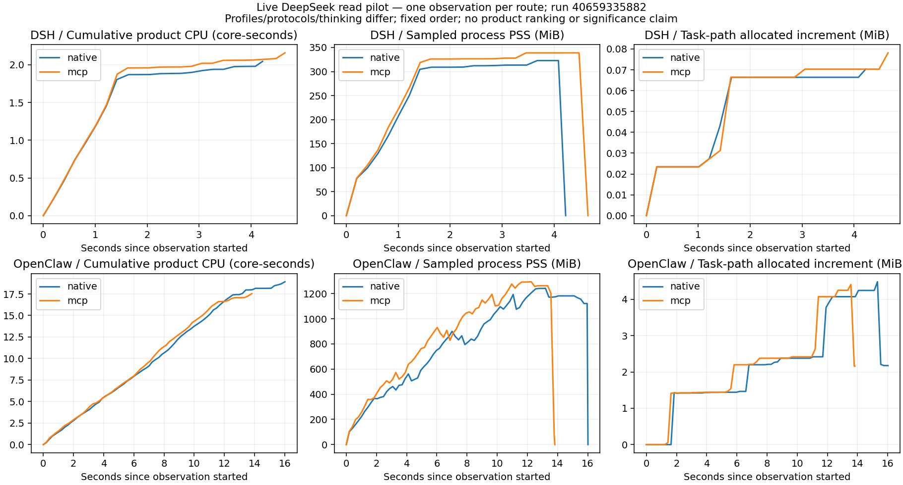
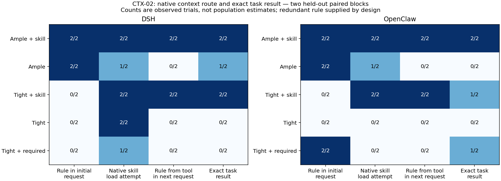
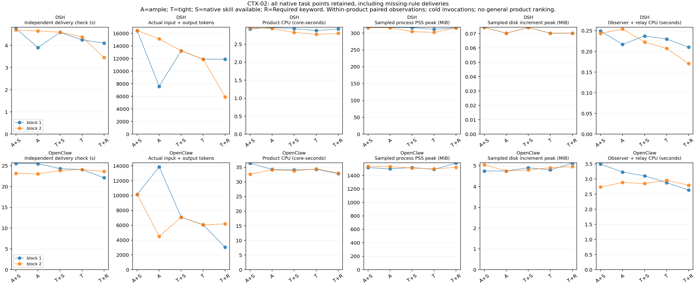

# Source-informed DSH / OpenClaw comparison and evidence reuse

This source-informed comparison binds DSH `dsh-v0.2.2-alpha.2` (`f3803c96974ad4a94195fb97e5c637e9c2a3afe3`) and the existing OpenClaw `2026.10.7` campaign (`157d8c2bc3ea2fa183afdc11088e69690bf8e64e`). The DSH source tag resolves to that commit; association with the installed npm runtime still needs build/package calibration. The current OpenClaw release is now `2026.10.8` (`dc2523e5a5c7a309517fd7fa834add938231d526`). The [version bridge](evidence/source-informed-20261028/version-bridge.json) checks all 14 selected OpenClaw source files: their blobs are unchanged from 10.7. This is source continuity only, not whole-program/runtime equivalence; new calibration uses 10.8 and old results keep 10.7 labels. DSH npm `latest` currently selects `0.2.1-rc.2`; the explicitly selected 0.2.2-alpha.2 channel remains separately declared. The local product checkouts were older and are excluded from these source findings. [Source manifest](source-review-manifest.json) records 41 fetched pinned files and Git blob identities; it is not an assertion that every possible implementation was exhaustively reviewed.

The historical campaign was re-audited using its original validator: **257 scenarios, 253 measured scenarios, 969 accepted measured observations, four verified capability exclusions**. This is 60 experiment families, not 257 independent experiment families. The 29 scenarios retaining failed acceptance are retained as evidence. Invalid/quarantined originals and calibration are excluded. [Reuse audit](evidence/source-informed-20261028/reuse-audit.md) maps all scenarios to candidate questions and permanent ZIP hashes without giving them new-comparison coverage credit.

## Mechanisms change what can fairly be compared

| Question | DSH pinned implementation inspected | OpenClaw pinned implementation inspected | Executable comparison and remaining uncertainty |
| --- | --- | --- | --- |
| Context / skills | `token-meter` builds replay-aware measurements; `compaction-basic` reads the meter, routed context capacity and reserved output, optionally prunes tool results, then summarizes. `agent-instructions.maxBytes` is a per-chain UTF-8 byte cap. `tool-skill` records scoped discovery/loading. | Bootstrap budgeting, native skill runtime and context-engine maintenance are distinct owners. | Compare actual request composition and preserved constraints under context pressure. Keep instruction bytes, estimated request tokens, provider usage and cumulative task tokens separate. Native independent skill-policy ablations still need profile/config binding. |
| Persistence / snapshot / rollback | `session-checkpoint-policy` flushes before model requests and top-level tool dispatch, and at pre-step boundaries. JSONL persistence owns session-log writes. | `backup-restore` verifies/extracts a whole archive to **fresh staging outside live state**; activation is explicit and requires stopping/repointing the Gateway. Managed worktree snapshot restoration has a separate owner and resource/identity guards. | DSH semantic durability checkpoints are not proof of filesystem/process rollback. Compare continuation durability first; separately measure each genuinely exposed restore operation by its actual state domain. Do not treat OpenClaw archive extraction and activation as one instantaneous in-place rollback. DSH general rollback availability remains unverified, not declared absent from a filename search. |
| Budget | `token-meter` and pressure compaction form an evidenced measurement→policy→request-maintenance path. Goal files inspected describe durable goal changes/rounds; a cumulative task-tree token reservation controller was not established by this review. | `goal-tools.resolveGoalSessionScope` binds the actual run session; goal state includes token budget/status. Bootstrap/context controls are separate. | Existing COST-05 native probes already establish absence of the tested shared hard task-tree quota in this OpenClaw version. Reuse that scoped exclusion. Run context-pressure/skill adoption and per-session goal controls under their own contracts; do not manufacture a shared quota for either product. |
| Collaboration | `SubagentManager` retains lineage, admission and scoped teardown; final child state is flushed. Agent loop owns create/resume and ordered teardown. | Existing REL-03/REL-05/PERF-03 records cover delegated work, cancellation and tool scheduling. | Reuse OpenClaw mechanism observations. New same-work parent/child comparison still needs both products' native delegation, result joining and complete parent-plus-child usage. |
| Authority / sandbox | `sandbox-local` functionally probes platform providers, including Linux Bubblewrap; `tool-skill` resolves agent scope. | Existing authority/isolation families cover multiple native entry points, grants and OS boundaries. | Bind shipped DSH profile selection, filesystem provider and tool execution routes before denial probes. Separate outer test containment from product sandbox. Old OpenClaw samples retain their original grants and threat models. |
| Events | `agentEvents.emit` contains synchronous listener exceptions and rejected promises without awaiting notifications; `serial` and `waterfall` have different control semantics. OTLP export is another channel. | The inspected session event bus uses synchronous EventEmitter delivery with handler exception containment. Diagnostics uses OTel `BatchLogRecordProcessor`; canonical state is a different persistence boundary. | Compare notification isolation, control middleware and remote telemetry separately. A synchronous busy listener can still delay the event loop even when exceptions are contained. Reuse OBS-02 collector outage/loss observations; they do not establish loss in every internal event path. |
| Self-improvement | `tool-cordis` inspected here is **read-only runtime discovery**. Its name is not evidence of automatic runtime mutation. Skill registration/loading is present; a governed native feedback→promotion→reversal pipeline remains unverified. | Skill Workshop has eligibility/scheduling, detached review, inherited foreground context, change records and skill versions. Experience review requires native availability and excludes some background/internal contexts. | Exercise actual Workshop review and version adoption; discover DSH's supported update mechanism before choosing a counterpart. Do not credit ordinary writable skill files, read-only discovery or evaluator patches as native self-improvement. |

Pinned source entries and ownership are in the manifest. Particularly relevant anchors are DSH `packages/core/agent/src/dispatch.ts`, `packages/session/session-checkpoint-policy/src/index.ts`, `packages/compaction/compaction-basic/src/index.ts`, `packages/llm/token-meter/src/index.ts`; OpenClaw `src/commands/backup-restore.ts`, `src/agents/worktrees/snapshot-restore.ts`, `src/skills/workshop/experience-review*.ts`, `src/agents/tools/goal-tools.ts` and `extensions/diagnostics-otel/src/service-logs.ts`. Runtime conclusions require the public/native entry to reach those components; source existence is not default-profile activation proof.

## Memory and feedback contracts narrow the remaining comparison

The pinned DSH [memory integration guide](https://github.com/deepseek-ai/deepseek-harness/blob/f3803c96974ad4a94195fb97e5c637e9c2a3afe3/docs/user/guide/mcp-memory.md) explicitly says that no memory server is present in the shipped composition. Its three reference integrations are default-off third-party MCP configurations. The harness owns tool discovery and the stdio child lifecycle; the selected provider owns storage, retrieval semantics and its own prerequisites. Therefore HA must label a future enabled DSH arm by its actual provider/version and include that provider's child cost, with the same deployment's memory-disabled control. It cannot silently credit an external graph store as a shipped DSH memory subsystem. This is a documented composition boundary, not a claim that persistent memory cannot be added to DSH.

DSH's pinned [feedback contract](https://github.com/deepseek-ai/deepseek-harness/blob/f3803c96974ad4a94195fb97e5c637e9c2a3afe3/docs/subsystems/feedback.md) records message/session feedback in canonical log events. The contract says those events do not enter model context, and recording feedback does not itself trigger a model request; eligible telemetry delivery is a separate path. Those operations therefore do not establish HG's durable behavior-update/promotion/reversal loop. The repository's [agent-experience skill](https://github.com/deepseek-ai/deepseek-harness/blob/f3803c96974ad4a94195fb97e5c637e9c2a3afe3/.agents/skills/agent-experience/SKILL.md) provides authoring guidance for discoverability and context loading, rather than such an updater. DSH's supported counterpart to native OpenClaw Workshop still requires a verified implementation; an evaluator-written skill edit cannot fill that gap.

## Reuse decisions

1. **Reuse as accepted historical mechanism evidence:** preserve original scenario/unit IDs, product version, controller, acceptance assertions and original archive hashes. This can avoid redoing OpenClaw lifecycle, authority, telemetry-fault and recovery probes where the question is identical.
2. **Recover fields for quantitative reuse:** compact records often contain assertions rather than resource values. Read only hash-verified original summaries on disposable hosted workers, then check workload, grant, model, topology, clock and counter semantics. Missing CPU/time/token fields remain unknown.
3. **Reuse fixtures/controls while supplementing observations:** add peer OS/session witnesses for restore scope, skill/context payload attribution, and source-linked decision traces. Record supplements as new runs instead of rewriting old evidence.
4. **New mechanisms require new experiments:** COST-03's model-written `AGENTS.md` reuse does not complete Skill Workshop automatic review, sealed transfer/regression or native version reversal. Its real provider accounting is still useful for learning/reuse cost and stale-rule behavior.
5. **Cross-product resource comparisons require matched conditions:** old OpenClaw bounded hosts, task deadlines, model settings and different workloads cannot automatically become the baseline for a new DSH task. Retain old results as context when conditions differ.

No family is repeated merely because an original workflow has a collection-step failure: accepted records and retained evidence identity govern reuse. Verified unsupported scopes remain capability findings; incomplete adapters remain unfinished work.

## Reused evidence now extracted

`audit_reuse.py` has revalidated the historical campaign and emitted the scenario-level provenance inventory. The [hosted archive inspection](https://github.com/zyw02/agent-arch/actions/runs/40656560031) checked permanent ZIP hashes and inspected 42 exact-digest accepted native summaries across COST-03, COST-07, OBS-02 and REL-10. The [numeric-field inventory](evidence/source-informed-20261028/native-field-inventory.json) identifies real timing, PSS/RSS and CPU fields; their original measurement scopes are retained.

COST-03's 24 historical paired units were recomputed into [48 source-linked rows](evidence/source-informed-20261028/guide-reuse-metrics.csv), including learning, failed requests and all original acceptance outcomes. [Aggregate values](evidence/source-informed-20261028/guide-reuse-metrics-summary.json) use accepted deliveries as the denominator and retain unknown invoice cost. Single-delivery guide reuse used 41,638 known input/output tokens per accepted delivery versus 19,555 for the baseline after learning cost. Five-delivery reuse was 21,626 versus 20,049. The 20-delivery horizon did not complete all planned deliveries in either arm (79/120 reuse; 81/120 baseline). These observations do not establish a general benefit. This is agent-written guide reuse, not native Skill Workshop performance.

The [plotting run](https://github.com/zyw02/agent-arch/actions/runs/40657342012) retains figures and raw rows. Each line is one paired independent unit. Cache input is counted once; learning and failed work remain charged.

## Reused telemetry faults: task continuity and export durability differ

The [OBS-02 re-extraction](https://github.com/zyw02/agent-arch/actions/runs/40665701079) verifies the permanent archive and every accepted native summary, then joins **all 12 original scenario/unit records** to full event-ID partitions. It executes no product and makes no model calls. [Rows](evidence/source-informed-20261028/observability-reuse-metrics.csv), [summary](evidence/source-informed-20261028/observability-reuse-summary.json) and [provenance](evidence/source-informed-20261028/observability-reuse-provenance.json) retain original failure states and source hashes. Unlike the earlier bounded numeric inventory, this checks complete sets and counts.

| Original OpenClaw 2026.10.7 condition | Units | Target IDs offered / missing remotely | Missing local target IDs | Task during fault / after restoration | Fresh publication after restoration |
| --- | ---: | ---: | ---: | --- | --- |
| Brief collector fault | 3 | 24 / 24 | 0 | 3/3 / 3/3 | 3/3 |
| Long collector fault | 3 | 24 / 24 | 0 | 3/3 / 3/3 | 3/3 |
| Publisher killed and restarted | 3 | 24 / 24 | 0 | 3/3 / 3/3 | 0/3 |
| 4096-event burst with collector fault | 3 | 12,288 / 12,288 | 2 in one unit; 0 in the other two | 3/3 / 3/3 | 3/3 |

Missing remotely means absent at the declared final snapshot after recovery wait and native shutdown, not that no HTTP attempts occurred. The old failed batches were independently observed. The official `diagnostics-otel` exporter used the declared public diagnostic reference producer; native file logging was paired through distinct local offered IDs. The positive control first proved successful publication. The original SDK defaults were queue 2048 and batch 512; this is not an evaluator-installed durable queue. Two local IDs were missing in burst unit 1, while burst units 2 and 3 retained their full local sets. Logs can therefore support local diagnosis even when the export has gaps, but successful task recovery does not establish recovery of the telemetry publisher. The lossless criterion belongs to this experiment and is not an assertion of a product durable-spool guarantee.

These are scoped historical observations. They do not establish loss in all native event paths, listener isolation, event ordering or diagnostic CPU overhead, and they are not a matched DSH comparison. A separate native listener/control contrast remains necessary for HD; the pinned DSH notification exception handling and OpenClaw EventEmitter source findings cannot supply unmeasured runtime latency.

## Native execution and first real-model pilot

The initial [native-only calibration](https://github.com/zyw02/agent-arch/actions/runs/40657053283) proved actual file reads for DSH 0.2.2-alpha.2 and OpenClaw 2026.10.8. The subsequent [four-arm calibration](https://github.com/zyw02/agent-arch/actions/runs/40658964630) passed both native and public MCP routes for both products, including dedicated cgroup/PSS/disk collection. [Retained resource calibration](evidence/source-informed-20261028/native-mcp-resource-calibration.json) binds the original report and artifact ZIP hashes. Random file content was absent from the prompt, appeared in the tool result and terminal output, and the input remained unchanged. MCP additionally has an independent fixture call ledger. These are calibration observations with synthetic model usage, not real token costs.

The [first real DeepSeek pilot](https://github.com/zyw02/agent-arch/actions/runs/40659335882) then executed the same four routes with `deepseek-flash`. The relay forwarded actual native requests to DeepSeek's supported [Anthropic-compatible](https://api-docs.deepseek.com/guides/anthropic_api/) and OpenAI-compatible interfaces; it generated no answers or tool decisions. All four obtained the correct random content, used the requested tool, exited normally and returned complete provider usage and resource records. The API alias is `deepseek-flash`; its underlying model snapshot was not independently frozen.

The original pilot workflow is red because its evaluator required `VERIFIED:` immediately followed by the receipt; the model placed a space after the marker. The revised parser checks the actual terminal field and permits marker whitespace while requiring exact file content. The [retained-evidence reanalysis](https://github.com/zyw02/agent-arch/actions/runs/40660343474) verifies the original ZIP and receipt hashes, preserves the original failed judgments, and records a separate revalidated result. It makes **zero new model calls and executes no native products**. This is exploratory pilot revalidation, not retrospective formal experiment credit.

[Original pilot record](evidence/source-informed-20261028/read-pilot-original-report.json.gz) is retained in the repository with its original uncompressed SHA-256, so revalidation does not depend on expiring Actions artifacts. [Provenance](evidence/source-informed-20261028/read-pilot-provenance.json) binds source/reanalysis archives, controller and derived file hashes.

[Compact pilot evidence](evidence/source-informed-20261028/read-pilot-summary.json), [resource rows](evidence/source-informed-20261028/read-resource-metrics.csv) and [per-request usage](evidence/source-informed-20261028/read-request-usage.json) keep source identities, original/revised acceptance, auxiliary calls, resource samples and missing fields explicit. All four native task totals agree with the independently observed provider task totals. DSH additionally made one session-title request per arm, costing 185 and 195 tokens respectively; those requests remain in total task-associated cost.

Token normalization respects protocol semantics. Anthropic's `input_tokens` excludes separately reported cache reads/writes, so the input partitions are combined; see the [API counter definition](https://platform.claude.com/docs/en/build-with-claude/prompt-caching). DeepSeek's OpenAI-style `prompt_tokens` is inclusive, so cache-hit fields are not added again. Stream cumulative updates are merged, not summed. Native OpenClaw configured-provider metadata reported `cost.total=0`; this is not an invoice and does not mean the real calls were free. Actual invoice charge remains unknown.

This figure is a measurement-chain check, **not a product ranking**. There is one observation per route, in fixed order. Product contexts, exposed tools, protocol and thinking settings differ; DSH retains its shipped headless behavior and OpenClaw uses an explicit local tool allowlist with workspace bootstrap creation skipped. Installation/cache state and CPU/memory caps are recorded. Ordinary startup dominates this tiny task and has not been separated from steady-state execution.

The cgroup measures the product and inherited tool/MCP processes. A short privileged launcher migrates only that invocation, then drops to the original worker UID/GID before executing the product. The relay/controller and sampling thread remain outside; their full process cost is not yet attributed. PSS/RSS samples, kernel memory charge peak and disk allocation are separate quantities. Shared file-page charging can make process PSS exceed this cgroup's charged peak. Sampled peaks can miss short-lived changes. Raw cgroup I/O records do not imply flushed physical writes; shared installation, cleanup and retained evidence are separately scoped. Wall time currently means invocation start to process exit; a separately timestamped independent acceptance event remains to be added for formal task-delivery latency. Fine-grained context-source token attribution remains unobserved; payload bytes are not tokens.

OpenClaw native metadata also records a pre-prompt `contextBudgetStatus` with owner, estimate, reserve and route (`fits` in this small pilot). The MCP arm reports `replayInvalid=true` despite successful current-turn delivery. Both facts are retained as observations requiring targeted context/recovery follow-up; they are not treated as proof of pressure handling or failed task delivery.

## Instruction-budget and skill study: retained exploration and corrected follow-up

The [CTX-01 run](https://github.com/zyw02/agent-arch/actions/runs/40664174817) completed ten synthetic calibration controls and twenty real-model arms in two randomized blocks. All resource records are complete and there are no provider errors. Its [original reports, all derived rows and figures](evidence/context-skill-01-20261028/provenance.json) are permanently retained, including failed judgments: 16/20 format deliveries, 3/20 exact answers and 1/20 original full acceptance. The blue cells in those original exploratory figures do **not** confer formal study credit.

Inspection found two evaluator/fixture problems. The ample no-skill arm supplied random codec parameters but omitted the checksum algorithm from both AGENTS and the common user prompt; only the skill supplied it. That arm therefore fails as an independently feasible quality positive control. Synthetic calibration knew the algorithm internally and did not detect the defect. OpenClaw also exposed and used its native exact-name `skills_read` loader; the scorer only recognized path-based `read`. The original scorer additionally counted unrelated `read` calls as skill attempts. [Defect disposition](evidence/context-skill-01-20261028/summary.json) withdraws causal quality and difference-in-differences claims from this exploration rather than rewriting outcomes. Source projection observations and independently collected usage/resources remain evidence under their actual scope.

[CTX-02 preregistration](context-skill-protocol.json) supplies the algorithm in the identical user prompt for every arm, leaving random parameters absent from the prompt. It binds both exact native loaders and exact advertised paths, with negative checks for other reads/names. OpenClaw's [pinned installed-skill implementation](https://github.com/openclaw/openclaw/blob/dc2523e5a5c7a309517fd7fa834add938231d526/src/agents/tools/installed-skill-tools.ts) and actual model-visible schema establish the loader contract. Fresh random blocks are required; CTX-01 calls will not be repurposed as CTX-02 outcomes. Both studies are bootstrap/instruction-cap experiments and do not complete full-window compaction, dynamic skill optimization, hard task-tree quotas or self-improvement.

## CTX-02: observed instruction projection, skill route and task effects

The corrected [CTX-02 hosted run](https://github.com/zyw02/agent-arch/actions/runs/40665504454) completed ten calibration controls and **20 real-model arms in two complete randomized blocks**. It made 37 real provider calls, with zero provider/adapter errors. All 20 resource and provider-usage records are complete. The [offline summary](evidence/context-skill-02-20261028/summary.json) independently recomputes the original exact terminal judgments and reconciles **20/20 native task token totals** with normalized provider task totals. No extra model calls or native execution were used for that check. [Provenance and permanent raw reports](evidence/context-skill-02-20261028/provenance.json) bind the original ZIP, controller, preregistration, package lock and derived hashes.

Each entry below is a count out of two independent blocks. Exact answer and full acceptance are separate: the latter additionally requires valid delivery and allowed tool use. A null answer is a format delivery with incomplete task quality; it is the expected safe response when parameters are absent. These intentionally missing-parameter controls are not counted as product malfunctions.

| Condition | DSH initial rule | DSH exact / full | OpenClaw initial rule | OpenClaw exact / full |
| --- | --- | --- | --- | --- |
| Ample instructions + skill | 2/2 | 2/2 / 2/2 | 2/2 | 2/2 / 2/2 |
| Ample instructions, skill disabled | 2/2 | 1/2 / 0/2 | 2/2 | 0/2 / 0/2 |
| Tight instructions + skill | 0/2 | 2/2 / 2/2 | 0/2 | 1/2 / 1/2 |
| Tight instructions, skill disabled | 0/2 | 0/2 / 0/2 | 0/2 | 0/2 / 0/2 |
| Tight instructions, Required keyword, skill disabled | 0/2 | 0/2 / 0/2 | 2/2 | 1/2 / 0/2 |

The actual native request projection agrees with the pinned owners. Under the ASCII fixture's ample cap (16384), both products include the middle rule. Under the tight cap (1024), both omit the neutral rule. OpenClaw's keyword-sensitive policy digest retains the Required variant; DSH's prefix-based instruction-chain projection omits it. The limits have different native semantics—UTF-8 bytes per DSH rendered chain versus UTF-16 characters per OpenClaw bootstrap file—so ASCII source length does not make their renderers identical.

In all eight skill-enabled arms, the product-native loader returns the random rule and the next actual model request contains it. DSH uses `skill`; OpenClaw uses `skills_read`. The skill restores **parameter availability** in all four tight/skill arms, while exact task quality is 3/4: OpenClaw block 2 returns checksum 352 instead of 328 despite receiving the rule. Source projection and successful tool loading therefore do not imply correct model computation. The skill-disabled ample controls also show model/format/tool-use failures; their poor outcomes prevent a broad claim that skill loading reliably improves arbitrary tasks. One DSH exact ample/no-skill answer and one OpenClaw exact Required answer violate tool constraints and receive no full acceptance. Unavailable skill attempts and unrelated BOOTSTRAP reads remain charged and classified as violations.

The native skill-loading instruction is explicit in the common task, and the same rule is deliberately duplicated into the optional skill. This identifies two native context routes; it is not evidence of an independently optimized adaptive skill selector. The column labeled load attempt includes attempts to load a disabled/unknown skill. Original figure files are retained; its label was clarified offline without changing any values or judgments.

| Same-product paired skill-enabled condition | Actual input + output tokens, blocks 1 / 2 | Delivery check seconds, blocks 1 / 2 | Exact / full outcomes |
| --- | --- | --- | --- |
| DSH ample + skill | 16,423 / 16,431 | 4.755 / 4.692 | 2/2 / 2/2 |
| DSH tight + skill | 13,223 / 13,227 | 4.591 / 4.597 | 2/2 / 2/2 |
| OpenClaw ample + skill | 10,141 / 10,155 | 25.547 / 23.188 | 2/2 / 2/2 |
| OpenClaw tight + skill | 7,075 / 7,079 | 24.306 / 23.874 | 1/2 / 1/2 |

Tight versus ample with the skill available removes 3200/3204 observed tokens in the two DSH pairs (about 19.5%), and 3066/3076 in the OpenClaw pairs (about 30.2–30.3%). Those token savings coexist with the quality outcomes shown above; they are not invoice savings or a population estimate. All failed work is included. The [37 per-request counter records](evidence/context-skill-02-20261028/context-skill-request-usage.json) and [20 task-resource rows](evidence/context-skill-02-20261028/context-skill-metrics.csv) retain every condition, rather than filtering for accepted answers.

For the tight/skill points, DSH product CPU is 2.828/2.931 core-seconds and sampled PSS 304.3/316.1 MiB; OpenClaw is 33.788/34.064 core-seconds and 1509.2/1516.9 MiB (ranges across the two points, not confidence intervals). Every arm uses a fresh CLI process and task-owned state with the recorded common two-core/3-GiB cgroup limits. Shared installation and OS caches are not reset between arms. These profiles still expose different native context/catalogs and wire protocols, and CLI startup is included; the figures do not rank steady-state platforms or isolate which subsystem causes the cross-product resource difference. The observer/relay and read-only memory-helper CPU are outside the product cgroup and reported separately, without double-counting the sampling thread. Disk sampling can miss brief peaks; shared package installation and cleanup are outside task-path increments. Delivery check time includes the independent check after process exit and is not first-token latency. Component-specific source token counts and actual invoice charges remain unknown.

CTX-02 completes this bounded instruction-projection/skill-route comparison. HA still needs full-window compaction and persistent-memory interventions; HF still needs its supported budget-enforcement and independent-policy contrasts. Native self-improvement, rollback, collaboration and platform fault/concurrency experiments remain separate work.

## Platform API and process-ownership preparation

The [native server API calibration](https://github.com/zyw02/agent-arch/actions/runs/40669456421) now passes for both DSH Web and OpenClaw Gateway. These are the long-lived platform entries; earlier Harness headless/embedded observations do not stand in for their lifecycle. Each calibrated native server processes two distinct sessions through its public authenticated API. All four random input markers reach the independent synthetic provider and return through the native result surface. An offline recheck confirms the DSH create-result identities, OpenClaw native Runtime session-key projections, and disjoint marker contexts in the actual requests; client-generated IDs alone are not the isolation witness. OpenClaw appends that Runtime projection in a user-role block, which is not labeled a system instruction. No real provider credentials or paid model calls are used. [Original evidence and provenance](evidence/platform-api-20261028/attempt-2-provenance.json) retain the requests, API results, native process map, package lock and cgroup samples.

| Single calibration per declared server profile | Startup to carrier readiness | First / second independent task | Synthetic provider requests | Resource record |
| --- | --- | --- | ---: | --- |
| DSH Web, public session create/prompt/wait API | 3.655 s | 0.228 / 0.138 s | 4, including title work | Complete |
| OpenClaw Gateway, public HTTP chat completions | 12.804 s | 17.166 / 0.954 s | 2 | Complete |

These are preparation measurements, not PC lifecycle/concurrency conclusions. The complete observed lifecycle includes startup, both tasks and cleanup: DSH CPU 5.409 core-seconds and sampled PSS peak 437.5 MiB; OpenClaw CPU 51.853 core-seconds and PSS 2008.6 MiB. The figures describe these explicit profiles and one host sample. Carrier readiness and the first usable agent request differ, especially when native components activate lazily; additional idle, warm, equal-work and concurrent conditions remain necessary. Synthetic fixture counters and native HTTP usage fields are not real costs.

The startup cgroup snapshot contains one DSH Web Node process; OpenClaw contains its Gateway plus spawn-broker and SQLite-readonly workers. The service PID differs from the external privileged launch monitor. PA must target the witnessed service process and preserve the healthy companion; killing only the wrapper or entire cgroup would exercise a different boundary. The [first failed calibration](evidence/platform-api-20261028/attempt-1-provenance.json) remains retained: DSH launcher `--patch` was placed after app-owned flags and was rejected before any model request. The repaired invocation puts profile/patch arguments first, as the pinned launcher contract requires. That adapter error earns no product task-failure credit.

[Platform source bindings](platform-source-bindings.json) also separate transport loss from cancellation: the OpenClaw Gateway CLI explicitly sends `chat.abort` on SIGINT/SIGTERM after acceptance, whereas an abrupt disconnect is not the same action. DSH's public `session.prompt` acknowledges admission separately from `session.wait`. Before formal PA admission, the complete fault/recovery pilot must verify the actual client and owner boundaries, surviving work, companion outcome, native persistence and a reconstruction made from native evidence alone. The [calibration protocol](platform-api-calibration-protocol.json) deliberately does not claim those unexecuted interventions.

## Next native work, informed by these findings

1. **Context and budgets:** extend the validated CTX-02 instruction/skill controls to full-window compaction and persistent memory, binding the actual native/provider owners and retained constraints. Independent adaptive-policy switches remain to be verified. Keep session goal targets, request/context reserves, bootstrap byte caps and hard task-tree quotas separate. Add source attribution only when independently measurable.
2. **Continuation and rollback:** reuse existing continuation/backup evidence, then add target/peer-session/OS witnesses around each actual restore operation. Test staged archive activation and managed-worktree restoration under their own state domains; do not label DSH semantic checkpoints filesystem rollback.
3. **Collaboration and authority:** bind both native delegation interfaces and verify complete parent/child accounting before failure/cancel or permission-attenuation probes. Reuse matching OpenClaw accepted evidence where the question and version scope agree.
4. **Self-improvement and events:** exercise native Workshop review/version adoption separately from COST-03 guide reuse; continue verifying DSH's supported update path. Reuse telemetry-outage evidence while separating notification listeners, control middleware, state persistence and OTLP export.

The read pilot still needs formal paired repetitions, independent acceptance timestamps and its remaining lifecycle interventions. CTX-02 adds two complete paired instruction/skill blocks, an independently timestamped post-exit delivery check, and separate observer CPU accounting. Source-specific token counts and external service costs remain unobserved. The ten-study design is not marked complete by these slices; H03 and H14 are in progress for DSH/OpenClaw in the [progress ledger](progress.json).
